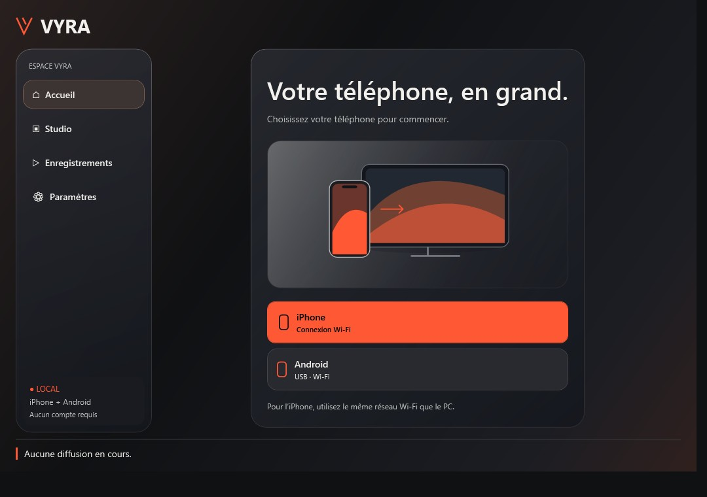

# VYRA

### Votre téléphone en grand, sur Windows.

Présentez une application, montrez un geste à l’écran ou enregistrez une démonstration depuis votre bureau.  
**Gratuit · Sans compte · Diffusion sur le réseau local**

[**Télécharger pour Windows 64 bits**](https://github.com/louvitox/VYRA-Releases/releases) &nbsp; · &nbsp; [Guide de connexion](#connecter-son-iphone) &nbsp; · &nbsp; [Nouveautés de VYRA](https://github.com/louvitox/VYRA-Releases/releases)

## Installer VYRA

Sur la [page des téléchargements](https://github.com/louvitox/VYRA-Releases/releases), ouvrez la version la plus récente et choisissez **`VYRA-Setup.exe`** dans **Assets**. Lancez le fichier et gardez le PC connecté à Internet pendant la préparation des composants. Quand le bouton **Ouvrir VYRA** apparaît, tout est prêt pour connecter votre téléphone.

## Connecter son iPhone

1. Connectez l’iPhone et le PC au même réseau privé. Dans VYRA, cliquez sur **Connecter un iPhone**.
2. Sur l’iPhone, ouvrez le **Centre de contrôle** et touchez **Recopie de l’écran**.
3. Sélectionnez le nom indiqué dans VYRA. La première image reçue ouvre la vue de diffusion.

| Pendant la diffusion | Comment faire |
| :--- | :--- |
| **Présenter en plein écran** | Double-cliquez sur l’image. Appuyez sur **Échap** pour revenir à la fenêtre. |
| **Prendre une capture** | Faites apparaître les commandes et choisissez **Capture**. |
| **Enregistrer une vidéo** | Cliquez sur **Enregistrer**, puis arrêtez l’enregistrement. Retrouvez la vidéo dans la galerie ou dans **Vidéos › VYRA** sur le PC. |
| **Ajuster le son** | Si le son du téléphone est activé, déplacez le curseur de volume pendant l’écoute. |
| **Privilégier les détails ou la fluidité** | Pour une présentation horizontale, essayez **Full HD paysage**. Si la diffusion saccade, choisissez **Équilibré**. Le profil d’image prend effet à la prochaine connexion. |

**Sur Android**, choisissez **Connecter un Android** depuis l’accueil. VYRA propose la connexion USB ou Wi-Fi. Le contrôle du téléphone nécessite votre autorisation.

## Assistance

<strong>Le PC n’apparaît pas sur l’iPhone</strong>

Vérifiez que VYRA attend la connexion et que les deux appareils utilisent le même réseau privé. Dans **Recopie de l’écran**, cherchez le nom affiché dans VYRA. Si le PC reste invisible, ouvrez **Paramètres › Assistance** dans l’application.

<strong>L’image manque de fluidité ou le son craque</strong>

Dans **Paramètres › Options avancées › Performances**, activez le moniteur pour comparer les images reçues et affichées. Un profil à 60 FPS est une cible : la cadence effective dépend du téléphone, du réseau et du PC. De courts craquements audio restent possibles dans la bêta.

<strong>Comment vérifier le téléchargement et recevoir les correctifs ?</strong>

Le Setup de la bêta est distribué sans signature Windows Authenticode. Pour vérifier le fichier téléchargé, comparez son empreinte SHA-256 avec **SHA256.txt**, fourni dans la même Release.

Dans les versions qui proposent **Rechercher les mises à jour au démarrage**, vous pouvez activer cette option dans les paramètres. VYRA demande votre accord avant d’ouvrir le nouvel installateur. Vous pouvez aussi télécharger les correctifs manuellement depuis les [versions officielles](https://github.com/louvitox/VYRA-Releases/releases).

